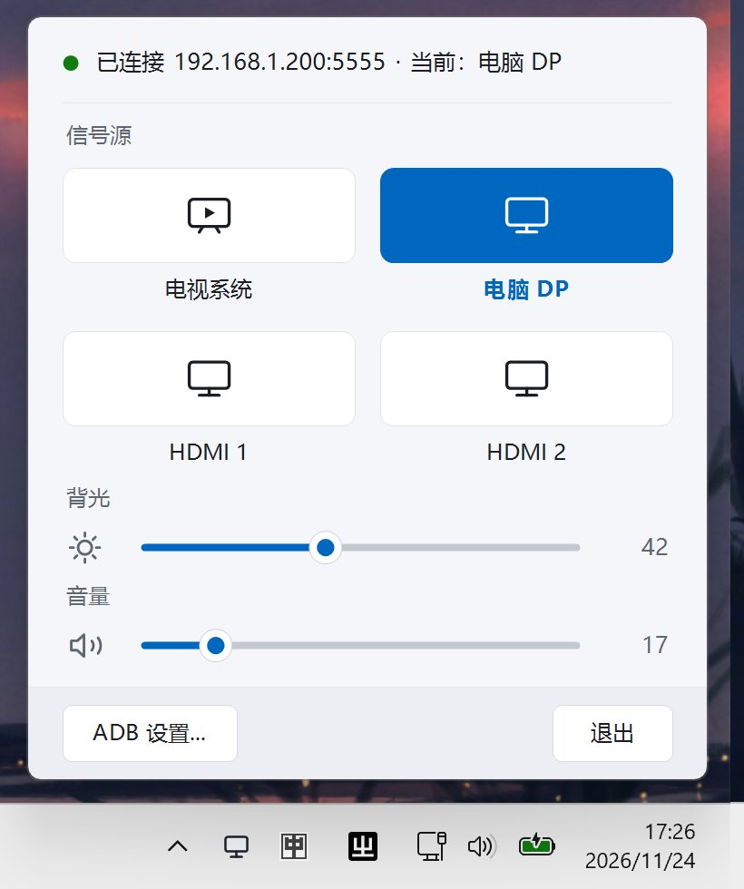
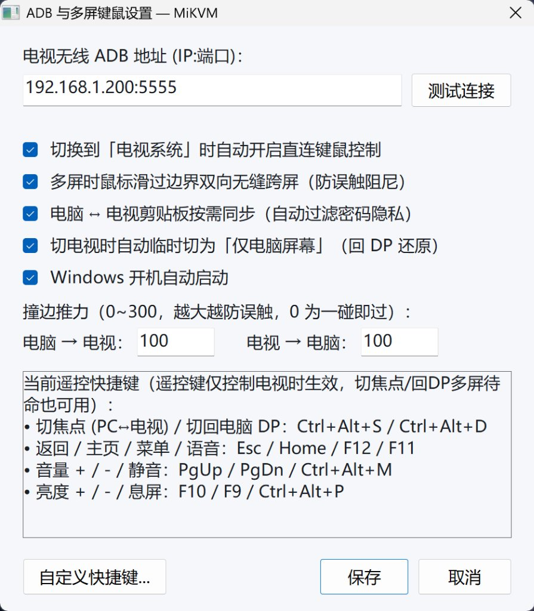
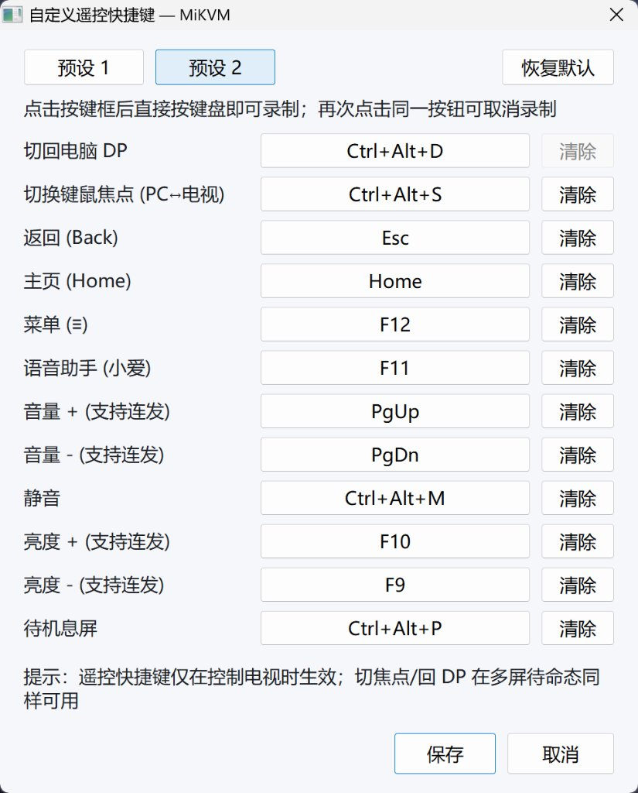

# MiKVM

[](LICENSE)
[](#环境要求与兼容性)
[](#从源码构建与开发者文档)

一款专为 **Redmi 显示器 G Pro 27U（MiTV-MFFU1 / beekeeper）** 及小米澎湃OS智能显示器打造的极轻量 **Windows 11 托盘切换器与多屏跨系统软件 KVM**。

无需遥控器、无需硬件 USB 切换器、不挑电脑键鼠——在电脑右下角即可一键切换 **电视系统 / 电脑 DP / HDMI 1 / HDMI 2**、**6–10 ms 毫秒级调节真实硬件背光与音量**，并通过纯 Rust **直连 `scrcpy-server` 控制通道**实现多屏无缝跨系统 KVM：显示器切到电视系统观影时，笔记本或副屏仍可自由办公，**鼠标滑过屏幕边缘或按快捷键即可在 Windows 与 Android TV 之间无缝穿梭**，对电脑端中文输入法零打扰。

## 界面预览

<table>
  <tr>
    <td align="center" width="33%">
      <br />
      <sub><b>Win11 原生圆角托盘浮窗</b></sub>
    </td>
    <td align="center" width="33%">
      <br />
      <sub><b>ADB 与多屏键鼠设置（含双向推力）</b></sub>
    </td>
    <td align="center" width="33%">
      <br />
      <sub><b>点击录制自定义遥控快捷键</b></sub>
    </td>
  </tr>
</table>

---

## 核心特性

- **多屏无缝跨系统软件 KVM（零硬件、零输入法打扰）**
  - **原生直连 `scrcpy-server` 控制通道**：纯 Rust 直连（无画面、无音频、免启动 `scrcpy.exe` / SDL3 / FFmpeg），不抢占 Windows 窗口焦点，电脑端中文输入法（小狼毫 / 微软拼音）零切换、零闪烁；自动探测适配 `scrcpy 3.0 ~ 5.x+` 任意版本，控制电视期间自动抑制 Windows 5 连 Shift 粘滞键弹窗。
  - **双向无缝滑边 + 单帧等高对齐（免 Root）**：内置极轻 `MiTVEdge.jar`（6.8 KB，源码见 [assets/MiTVEdge.java](assets/MiTVEdge.java)）3px 透明边沿传感器，鼠标可在电脑与电视之间双向平滑跨屏；切入电视采用预激发单帧突发算法，光标首帧即以 `±1px` 精度直达对应高度、无可见跳变。
  - **可调双向撞边推力（`0~300`）**：支持独立微调 `电脑 → 电视` 与 `电视 → 电脑` 推力阻力（`0` 为一碰即过，带 `260ms` 停顿衰减防误触）；扩展屏下采用弹性边界阻尼，且拖拽窗口或全屏游戏时自动暂停跨边。
  - **一键切焦点 + 单/多屏自适应**：随时按 `Ctrl + Alt + S`（可自定义）在电脑与电视间切焦点，双方对称记忆各自光标位置，控制电视时自动隐身电脑光标；笔记本合盖或「仅第二屏幕」自动切换为单屏独占电视，开盖即时恢复多屏。
  - **可选临时「仅电脑屏幕」防幽灵屏**：默认保持 Windows 扩展模式零闪屏；也支持在设置中勾选「切电视时自动临时切为仅电脑屏幕（回 DP 自动还原）」。
  - **PC ↔ TV 按需剪贴板同步**：自动双向同步文本剪贴板，自动过滤密码管理器标记的敏感隐私格式。
- **极简 Windows 11 原生体验**
  - 纯 Rust + Win32 / GDI+ 打造（仅单一依赖 `windows-sys`），**零运行库依赖**（不依赖 `.NET` / VC++ / WebView2 / Electron），单文件约 **500 KB**，待机 CPU **0%**。
  - 浮窗、托盘图标、设置页与快捷键录制框均自动跟随 **Windows 11 浅色 / 深色系统主题**与圆角动效；多屏场景下所有弹窗始终精准定位在可见电脑屏。
  - 左键托盘图标弹出控制面板，实时显示「控制电视中 / 电视待命 (焦点在电脑) / 已连接」状态；未连接（红点）时直接点击顶部状态行即可一键重连。
- **毫秒级硬件背光 & 音量直调（免 Root 也可用 DDC/CI 调光）**
  - **免 Root 支持**：电脑 DP / HDMI 模式下，未 Root 设备可通过 Windows 原生 **DDC/CI** 直调显示器物理背光，音量走原生 `cmd media_session` 并显示电视 OSD 音量条。
  - **Root 全模式加速**：内置轻量 `MiTVDaemon.jar`（3 KB，源码见 [assets/MiTVDaemon.java](assets/MiTVDaemon.java)），打开浮窗或进入电视会话时自动预热，电视/DP 全模式单次写入仅 **~6–10 ms**，空闲 25 秒自动退出零残留。
- **开箱即用：局域网一键扫设备 + 按需诊断日志**
  - 设置页内置「**扫描设备**」按钮，并发探测同局域网 `5555` 无线 ADB 端口并优先识别小米/红米智能显示器，免去手动查路由器 IP 的麻烦。
  - 默认关闭零开销日志；排查问题时可在 `config.ini` 设置 `DebugLog=True` 或以 `--debug-log` 启动，自动写入同目录 `mikvm.log`（满 512 KB 自动轮转）。
- **可视化自定义遥控快捷键 + 原生小爱远场语音**
  - 在「ADB 设置... → 自定义快捷键...」中支持 **点击录制按键**、冲突检测、防误录保护，以及一键切换 **预设 1 / 预设 2**。
  - 遥控键仅在控制电视时生效，`切焦点` 与 `切回电脑 DP` 在多屏待命态同样全局可用；切回 DP 后自动卸载全部钩子，绝不影响游戏与日常办公。
  - 默认键位（均支持自由修改或清空）：
    - `Ctrl + Alt + S`：多屏模式下在电脑与电视间一键切换键鼠焦点（保持电视画面）
    - `Ctrl + Alt + D`：任意界面一键释控并切回电脑 DP
    - `↑ / ↓ / ← / →` / `Enter` / 鼠标滚轮：方向键与确认（鼠标滚轮默认映射为电视上下/左右方向键）
    - `Esc` / 鼠标后退侧键：返回（`KEYCODE_BACK`）
    - `Home` / 鼠标中键或前进侧键：主页（`KEYCODE_HOME`）
    - `F12`：小米遥控器菜单键 `≡`（`KEYCODE_MENU`）
    - `F11`：**小爱语音助手**（调用原厂 `ONBOARD_MIC_START` 直接启用显示器自带远场麦克风收音，**免 Root**，单按即说、说完自动断句）
    - `PgUp` / `PgDn`：电视音量 `+` / `-`（支持长按连发）
    - `Ctrl + Alt + ↑ / ↓`（预设 2 为 `F10 / F9`）：显示器硬件亮度 `+` / `-`（步进 5%，支持长按连发）
    - `Ctrl + Alt + M`：静音；`Ctrl + Alt + P`：电源息屏待机

---

## 环境要求与兼容性

### 1. 电视 / 智能显示器端
- **Redmi G Pro 27U**（其他小米澎湃OS / MIUI TV 显示器或电视也可在 `config.ini` 中调整 `DpInput / Hdmi1Input / Hdmi2Input` 适配）。
- 已开启无线 ADB（5555 端口），与电脑处于同一局域网（建议在路由器为显示器绑定静态 IP；若已 Root，推荐配合 `MiTV ADB Keeper` 保持开机常开 ADB）。

| 功能 | 免 Root | 已 Root |
| :--- | :---: | :---: |
| 信号源切换（电视 / DP / HDMI 1 / HDMI 2） | ✅ | ✅ |
| 直连 `scrcpy-server` 无线键鼠控制 + 自定义快捷键 | ✅ | ✅ |
| 多屏双向滑边跨屏（`MiTVEdge.jar`）+ 单帧等高对齐 | ✅ | ✅ |
| 电脑 ↔ 电视剪贴板按需同步（自动隐私过滤） | ✅ | ✅ |
| 小爱机身远场语音助手（`F11`） | ✅ | ✅ |
| 电视音量调节（`PgUp/PgDn` 及面板音量滑块） | ✅ | ✅（6–10 ms 桥接） |
| 真实硬件背光直写（面板背光滑块 + 亮度快捷键） | ✅（电脑 DP/HDMI 下 DDC/CI） | ✅（全模式 6–10 ms 桥接） |

### 2. 电脑端
- **Windows 10 / 11**（纯原生 Win32 可执行文件，零运行库；对电脑键鼠类型、连接方式与配列无任何限制）。
- [Releases](https://github.com/Reeeabc/MiKVM/releases) 提供 **完整开箱版（`full.zip`，已内置官方 `adb` 与 `scrcpy-server`）** 和 **精简版（`lite.zip`，适合已装过 `scrcpy` 的用户，支持自动识别同级 `scrcpy/` 目录或系统环境变量 `PATH`）**。

---

## 快速使用

1. **新手推荐（开箱即用）**：从 [Releases](https://github.com/Reeeabc/MiKVM/releases) 下载 **`MiKVM-windows-x64-full.zip`**，解压到任意文件夹。
   > 若下载精简版 `MiKVM-windows-x64-lite.zip` 或从源码编译，可将 [scrcpy Windows 64-bit](https://github.com/Genymobile/scrcpy/releases/latest) 解压到同级 `scrcpy/` 目录（需包含 `adb.exe` 与 `scrcpy-server`，或确保两者已在系统 `PATH` 中）。
2. 双击运行 **`MiKVM.exe`**，左键点击右下角托盘图标打开浮窗 → 点击 **「ADB 设置...」** → 填入显示器无线 ADB 地址（如 `192.168.1.200:5555`），按需微调双向撞边推力（`0~300`）并保存即可使用。

---

## 电视端中文输入法推荐（配合电脑实体键盘打字）

电视自带的搜狗 TV 输入法主要面向遥控器五向键，用电脑实体键盘输入中文体验较差。推荐按是否 Root 选择以下方案：

### 1. 免 Root 首选：同文输入法（[Trime](https://github.com/osfans/trime/releases) / Rime 引擎）
- **特点**：**完全不需要 Root，不需要任何 Xposed 模块**，实测开箱即可配合 `MiKVM` 正常使用电脑键盘打中文。
- **配置步骤**：
  1. 在电视上安装 `com.osfans.trime-*-arm64-v8a-release.apk`；
  2. 打开一次「同文输入法」App 点击 **「部署」**，等待词库编译完成（约 10–20 秒）；
  3. 在电视「系统设置 → 通用设置 → 输入法」切为 **同文输入法**，或免 Root 执行：
     ```powershell
     adb shell ime enable com.osfans.trime/.ime.core.TrimeInputMethodService
     adb shell ime set com.osfans.trime/.ime.core.TrimeInputMethodService
     ```
- **进阶词库**：可导入 [雾凇拼音（rime-ice）](https://github.com/iDvel/rime-ice)，与电脑端小狼毫（Weasel）共用同一套配置与词库。若需访问外部 `/sdcard/rime` 目录，免 Root 授权一次即可：
  ```powershell
  adb shell appops set com.osfans.trime MANAGE_EXTERNAL_STORAGE allow
  ```

### 2. 已 Root 进阶方案：小企鹅输入法（[Fcitx5 for Android](https://github.com/fcitx5-android/fcitx5-android/releases)）
- **特点**：启动快、自带现代简体拼音词库、实体键盘悬浮候选条精致小巧。
- **注意点**：在小米澎湃OS TV 上直接安装时，非输入框界面容易抢焦点/拦截方向键，需在 Root + Zygisk（LSPosed / Vector）环境下搭配本仓库附带的轻量修复模块 **[extras/Fcitx5TvFix](extras/Fcitx5TvFix/README.md)**（仅 Hook `org.fcitx.fcitx5.android`，不改系统框架）。

---

## 从源码构建与开发者文档

需要 Rust 工具链（Windows MSVC 或 MinGW/GNU 均可）：

```powershell
cargo build --release
copy target\release\MiKVM.exe .\MiKVM.exe
```

- 详细架构设计、`MiTVDaemon` / `MiTVEdge` 协议与二次开发指南见 [docs/ARCHITECTURE.md](docs/ARCHITECTURE.md)（AI 协作维护规范见 [AGENTS.md](AGENTS.md)）。
- 如需早期无外部依赖的 C# (.NET Framework 4) 原型版本源码，请切换至历史标签 `v1.0-csharp`。

---

## macOS 支持计划

目前正式发布版为经过真机充分验证的 **Windows 10 / 11 原生版**。项目已在 `Cargo.toml` 中隔离 Windows 依赖，且核心控制通道 `src/scrcpy_proto.rs` 与 `adb.rs` / `config.rs` / `keymap.rs` 完全跨平台，欢迎拥有 macOS 与 Redmi G Pro 27U 的开发者通过 PR 贡献 macOS 适配层。急用的 macOS 用户现阶段也可参考同生态的 [redmi-g-pro-27u-monitorswitch](https://github.com/HanHan666666/redmi-g-pro-27u-monitorswitch)。

---

## 致谢与许可

- 本项目采用 [MIT License](LICENSE) 开源。
- 信号源指令、面板交互灵感及 `VolDirectTool.jar` 来自 [HanHan666666/redmi-g-pro-27u-monitorswitch](https://github.com/HanHan666666/redmi-g-pro-27u-monitorswitch)（MIT）。
- `MtkDirectTool.jar` 及 MTK 背光寄存器读写方案来自 [YiHoooong/Mimonitor_Toolbox](https://github.com/YiHoooong/Mimonitor_Toolbox)（MIT）。
- 电视端直连控制服务基于 [Genymobile/scrcpy](https://github.com/Genymobile/scrcpy)（Apache-2.0）。
- 详细第三方声明见 [THIRD_PARTY_NOTICES.md](THIRD_PARTY_NOTICES.md)。
